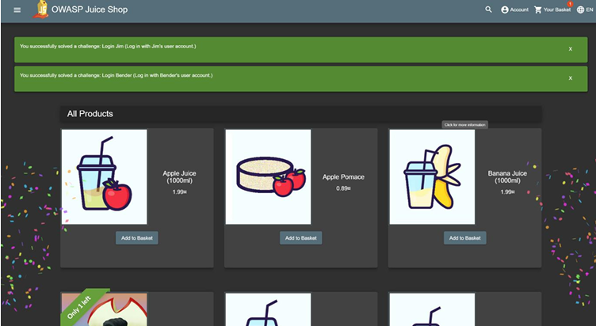
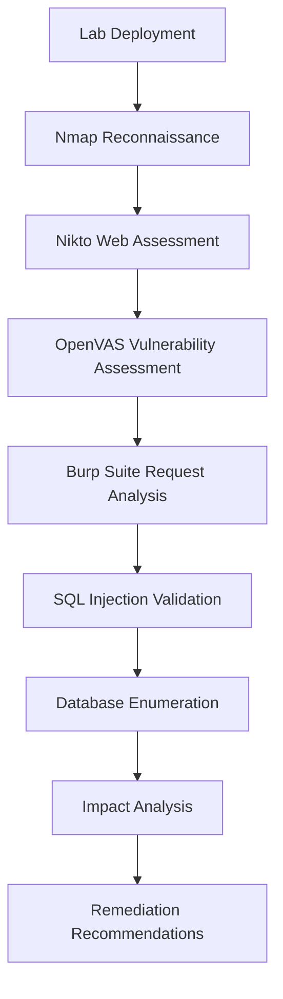
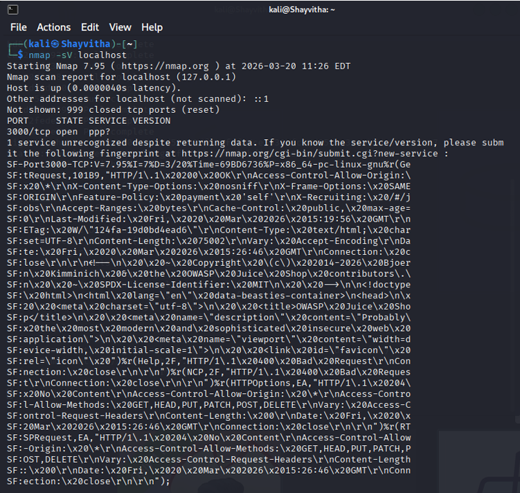
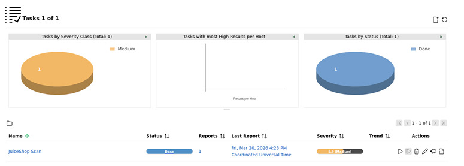
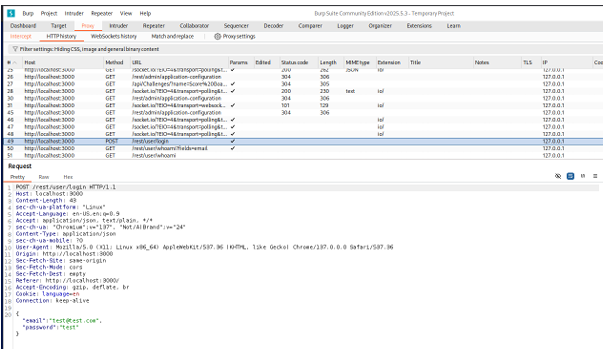
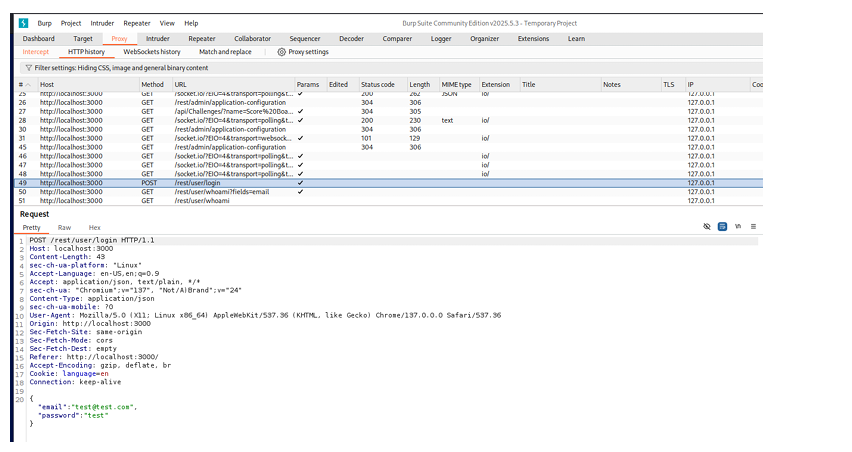
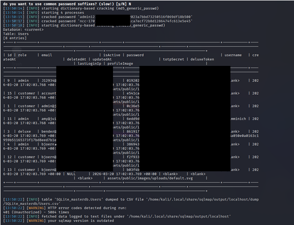

# OWASP Juice Shop Vulnerability Assessment & Penetration Testing Lab

This repository documents an authorized, controlled Vulnerability Assessment and Penetration Testing (VAPT) exercise against OWASP Juice Shop within an isolated local lab environment. 

**Kali Linux • Docker • Nmap • Nikto • OpenVAS • Burp Suite • SQLmap**

---

## 1. Project Overview
This project is a portfolio reconstruction of academic VAPT work. It details a structured assessment spanning network reconnaissance, automated vulnerability scanning, manual traffic inspection, and the controlled validation of an identified SQL Injection vulnerability. 

*Figure 1: OWASP Juice Shop application running within the isolated Docker lab environment.*

## 2. Assessment Objectives
- Perform authorized reconnaissance and service enumeration on a dedicated target.
- Identify potential misconfigurations and vulnerabilities using automated scanners.
- Manually inspect application traffic to isolate vulnerable input vectors.
- Validate a selected SQL injection vulnerability using controlled tooling.
- Evaluate the potential impact on the application's confidentiality, integrity, and availability.
- Develop practical remediation recommendations to address the observed findings.

## 3. Lab Environment
- **Attacker Platform**: Kali Linux
- **Target Application**: OWASP Juice Shop (intentionally vulnerable web application)
- **Deployment Strategy**: Containerized via Docker
- **Network Scope**: Localhost (127.0.0.1) / Isolated virtual network

## 4. Assessment Workflow

## 5. Key Findings
Reconnaissance successfully mapped the attack surface, identifying the active web service and associated components. Automated assessment tools reported multiple configuration weaknesses and application-layer vulnerabilities.

*Figure 2: Nmap service enumeration identifying the application listening on port 3000.*

*Figure 3: OpenVAS dashboard summarizing the automated vulnerability scan tasks and observations.*

## 6. SQL Injection Case Study
Following the automated assessment, manual request inspection identified the authentication request used for controlled SQL injection validation. The intercepted HTTP request was then used as the basis for further validation with SQLmap.

*Figure 4: Burp Suite intercepting the targeted HTTP POST request for controlled validation.*

*Figure 5: SQLmap successfully identifying blind SQL injection vulnerabilities within the targeted request parameter.*

## 7. Security Impact
The validated vulnerability demonstrated severe security consequences, notably the compromise of application confidentiality through unauthorized database enumeration.

*Figure 6: Demonstration of database exposure (sensitive values have been intentionally redacted for public publication).*

## 8. Remediation
Recommendations were formulated focusing on defensive coding practices, including the implementation of parameterized queries, robust server-side input validation, and the principle of least privilege for backend database access.

## 9. Evidence
All technical claims are supported by screenshot evidence derived directly from the original controlled lab exercise. Please see the [evidence directory](evidence/) for the complete visual record. Sensitive information (such as password hashes and real email addresses) has been intentionally redacted prior to publication.

## 10. Documentation
For detailed methodologies and step-by-step analysis, review the documentation files:
- [Assessment Methodology](docs/methodology.md)
- [Reconnaissance](docs/reconnaissance.md)
- [Vulnerability Assessment](docs/vulnerability-assessment.md)
- [SQL Injection Validation](docs/sql-injection-validation.md)
- [Security Impact](docs/security-impact.md)
- [Remediation Recommendations](docs/remediation.md)

## 11. Skills Demonstrated
- Network and service enumeration.
- Automated vulnerability scanning and result interpretation.
- Web proxy interception and manual HTTP request analysis.
- Controlled SQL injection validation.
- Security risk impact assessment.
- Professional technical documentation.

## 12. Limitations
This repository is a portfolio showcase representing a point-in-time academic assessment. To ensure ethical publication, raw scan artifacts and comprehensive exploitation payloads are omitted. The documentation focuses on methodology and evidence of validation rather than functioning as an attack tutorial.

## 13. Ethical Scope
**OWASP Juice Shop is an intentionally vulnerable application designed exclusively for security training.**
This repository documents an authorized local VAPT assessment conducted strictly within a controlled laboratory environment. No third-party production systems, live networks, or real-world applications were targeted, tested, or compromised.
