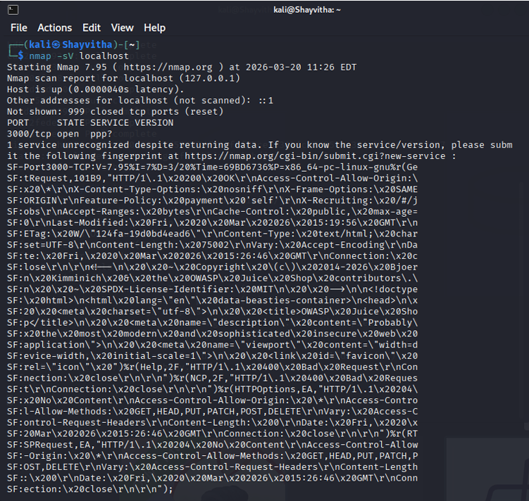

# Reconnaissance and Service Enumeration

The reconnaissance phase focused on actively mapping the target environment to identify accessible services and potential attack vectors.

## Network and Port Discovery
Using Nmap, the local environment was scanned to discover listening services. The assessment confirmed that the primary target application was accessible via HTTP on port 3000.

*Figure 1: Nmap service enumeration output confirming the target application listening on localhost port 3000.*

## Service Fingerprinting
The Nmap scan results (as shown in Figure 1) provided crucial context for the subsequent assessment phases:
- **Port State**: Port 3000 was confirmed open.
- **Service Identification**: The output indicated an HTTP service, revealing application-specific headers and metadata within the response.
- **Application Context**: The HTTP response headers explicitly referenced "OWASP Juice Shop", confirming the identity of the target application.

## Strategic Value
This initial reconnaissance was essential for defining the boundaries of the application and identifying the primary web interface. By confirming the exact port and service running, the assessment could proceed to targeted web-oriented vulnerability scanning and manual application mapping.
