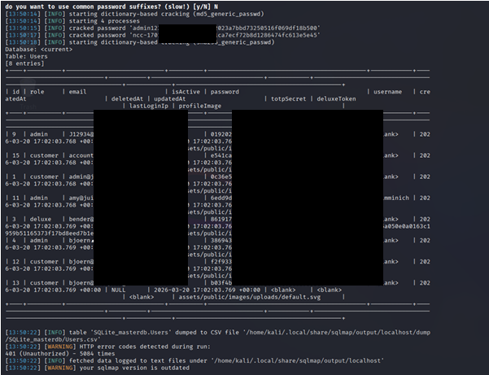

# Security Impact Analysis

The controlled validation of the SQL injection vulnerability demonstrated severe security implications for the target application. This analysis evaluates the impact using the Confidentiality, Integrity, and Availability (CIA) triad.

## Confidentiality Impact
**Assessment: High**

The SQL injection vulnerability allowed for the unauthorized extraction of database contents. During the assessment, controlled validation demonstrated direct access to the `Users` table, which contained sensitive authentication records.

*Figure 1: Demonstration of unauthorized data exposure via SQL injection.*

*Note: In Figure 1, actual email values, password hashes, and cracked plaintext passwords have been intentionally redacted with solid black boxes to ensure secure and ethical public portfolio publication. The visible headers and structural data confirm the successful enumeration of the table.*

The available evidence shows a failure of confidentiality controls, allowing an unauthenticated attacker to extract sensitive data from the backend database.

## Integrity Impact
**Assessment: Potential**

While the controlled assessment focused on demonstrating read access (enumeration), the nature of the validated SQL injection vulnerability typically permits unauthorized database modifications. As a potential consequence, a malicious actor could leverage this flaw to modify, insert, or delete database records. However, such unauthorized modification was not demonstrated in the preserved evidence.

## Availability Impact
**Assessment: Potential**

Depending on the backend database permissions and configuration, SQL injection presents a potential risk to application availability. Potential consequences include resource exhaustion from intensive queries or database corruption. However, service interruption, data deletion, or measurable availability degradation were not executed or demonstrated during this assessment.
