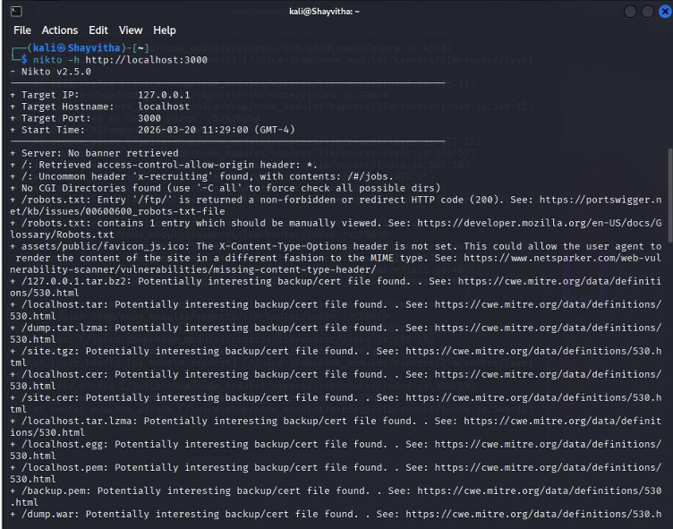
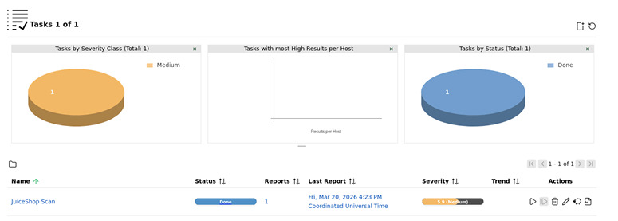
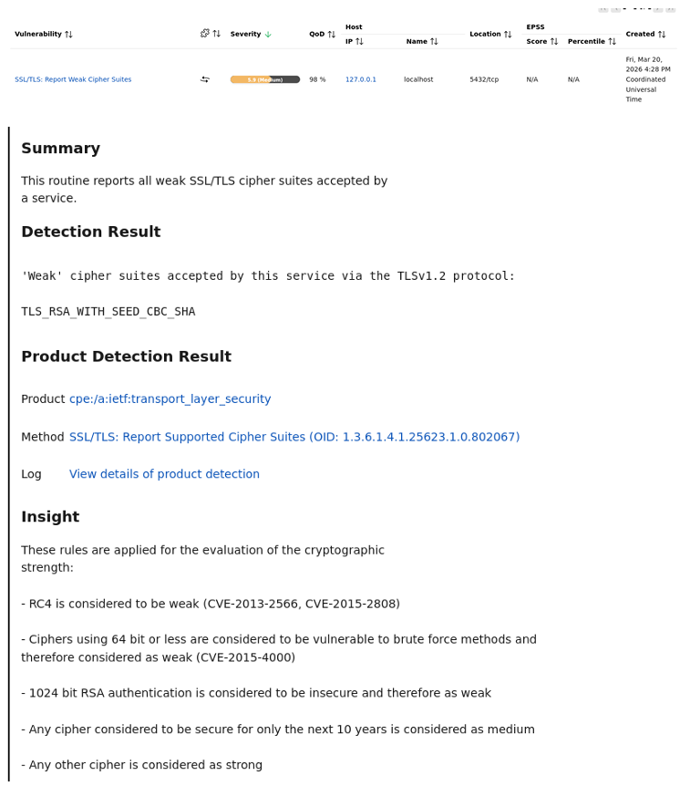

# Automated Vulnerability Assessment

Following the initial reconnaissance, automated vulnerability assessment tools were deployed to identify potential misconfigurations, known software flaws, and structural weaknesses within the target application and its hosting environment.

## 1. Web Application Scanning (Nikto)
Nikto was utilized to perform a targeted web-server assessment against the HTTP service identified on port 3000. 

*Figure 1: Nikto assessment reporting observations related to web server configurations and HTTP headers.*

**Observations:**
The Nikto scan highlighted several application-oriented observations, including the absence of certain security-centric HTTP headers (e.g., `X-Content-Type-Options`) and the presence of potentially interesting backup or certificate files. These findings provided initial indicators of the application's baseline security configuration.

## 2. Comprehensive Vulnerability Scanning (OpenVAS)
To broaden the assessment scope, OpenVAS was deployed to scan for a wider array of vulnerabilities and configuration deficiencies.

*Figure 2: OpenVAS dashboard reflecting the completion of the automated scan task.*

*Figure 3: OpenVAS finding detail identifying weak SSL/TLS cipher suites.*

**Observations:**
The OpenVAS assessment generated findings related to the underlying service configurations. For example, as demonstrated in Figure 3, the scanner reported the acceptance of weak SSL/TLS cipher suites (e.g., `TLS_RSA_WITH_SEED_CBC_SHA`). While this finding indicates a configuration weakness that could impact data-in-transit security, it served as a supplementary observation alongside the application-layer flaws.

## Conclusion of Automated Assessment
The automated tools successfully flagged a variety of configuration issues and potential vulnerabilities. These observations formed the basis for prioritizing manual inspection, ultimately leading to the targeted validation of severe application-layer flaws such as SQL Injection.
